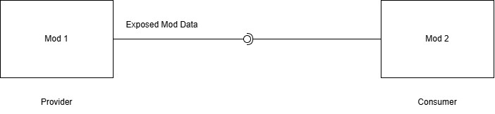

# Gothic 1 Remake Inter-Mod Protocol (GIMP)

GIMP aims to let Gothic 1 Remake mods exchange structured information without
hardcoding other mods' script classes or requiring every provider to be installed. The idea is to achieve lower coupling.

**Current protocol version: 2.** Version 1 is already used by released mods. The specification below describes v2; v1 endpoints must not be interpreted as v2.

## How it works

### Basics

We distinguish:
- Providers: they offer data via a standard interface and format (GIMP)
- Consumers: they consume data provided by other mods using GIMP

A mod can be both at the same time, a provider and consumer.
A mod exposes data over __one__ interface.
A mod can consume from __multiple__ sources / providers.



### Provider

To provide GIMP-compatible data, a mod:

1. Creates its endpoint during `HandleReadyForPlay()` or earlier and gives the actor the `GIMP` tag.
2. Stores its identity and typed key/value data in the endpoint.
3. Updates a value and sends that key's change notification when the value changes.

The following illustrates the data structure. The actual data lives in Unreal objects in memory; no JSON file or JSON parsing is needed.

```json
{
  "protocol": "GIMP",
  "protocolversion": 2,
  "modid": "exampleauthor.regeneration",
  "moddataversion": 1,
  "generation": "endpoint-guid",
  "values": {
    "regeneration.health.state": "active",
    "regeneration.health.ratePerSecond": 0.2,
    "regeneration.mana.state": "idle",
    "regeneration.mana.ratePerSecond": 0.5
  }
}
```
- `protocol` identifies that the mod supports GIMP
- `protocolversion` specifies the GIMP format version (`2` for this specification).
- `modid` identifies the data source and stays stable across updates.
- `moddataversion` identifies the version of the mod's data contract, independently of its release version. Increase it for breaking changes to keys, types, units or meaning; optional new keys can remain compatible.
- `generation` distinguishes endpoint instances; it is **not a shared game-session UUID**. Providers generate a new one when replacing their endpoint.
- `values` holds documented key/value pairs. Consumers recognize supported contracts and ignore unknown fields.

### Consumer

To consume GIMP-compatible data, a mod:

1. Discovers providers the next gameplay tick after `HandleReadyForPlay()` by calling `Gameplay::GetAllActorsWithTag(n"GIMP", Endpoints)`. An optional second scan after 10 gameplay seconds catches delayed providers; it cannot guarantee finding providers that appear later still.
2. Checks `protocol == "GIMP"` and `protocolversion == 2` before reading v2-specific fields or subscribing. Skip other versions unless a separate compatibility implementation supports them.
3. Checks `modid` to identify sources and `moddataversion` to confirm that their data contract is supported.
4. It then checks the key/data-store `values` for keys it wants to subscribe to.
5. When a value changes, the provider informs the registered consumer of which key changed and provides the change in the form: `key`, `value`. The consumer can then either act on that information directly, defer it to a queue or discard the value and poll the data himself upon receiving the notification.

## Technical details

The discovery tag stays `GIMP` for every protocol version; the endpoint's `protocolversion` decides how it must be read. `moddataversion` remains separate: adopting GIMP v2 does not by itself change a mod's data contract version.

### How data is stored

The current tested representation uses native `UBlackboardComponent` objects:
- The tagged actor's Blackboard stores `protocol`, `modid` and `generation` as strings, and `protocolversion` and `moddataversion` as integers.
- Its `values` entry holds an object reference to another Blackboard containing the actual key/value pairs.
- Value keys have explicit types: string or number (`float32` in this implementation). For example, use `GetValueAsString()` and `GetValueAsFloat()` to read them.
- Providers define the key names and types in `UBlackboardData` and initialize each Blackboard through `AAIController.UseBlackboard()`. This is the tested carrier; consumers only need native ModKit types, not the provider's custom script classes. Both sides must agree on each key's meaning, type and units. A notification therefore needs no separate `type` field: consumers use the supported data contract and validate the native entry type before reading it.

### How subscriptions and updates work

For each key that offers notifications, the provider creates a native `USceneComponent` on the value Blackboard's owner actor. The tested example uses a key named `random` and a signal component named `random`. Its `OnComponentActivated` delegate is used explicitly to deliver updates; it does not automatically observe Blackboard writes.

The consumer finds that component and binds its own callback:

```cpp
auto Signal = USceneComponent::Get(Values.GetOwner(), n"random");
if (IsValid(Signal))
    Signal.OnComponentActivated.AddUFunction(this, n"OnRandomChanged");
```

Read the current stored value once after subscribing. Subsequent notifications carry a separate native Blackboard snapshot containing `key` and its typed `value`. The event's component parameter refers to this snapshot, not the provider's current value store.

Declare the callback as `UFUNCTION() void OnRandomChanged(UActorComponent Component, bool Reset)`. Cast `Component` to `UBlackboardComponent`, validate it, then read the key and value using the type defined by the data contract.

The provider first updates its current value, prepares the snapshot and sends it:

```cpp
Signal.OnComponentActivated.Broadcast(Snapshot, false);
```

Only notify when the value changes. Each key has its own signal. This explicit `Broadcast()` does not activate or deactivate the component.

Callbacks run synchronously. The snapshot is borrowed for the callback: **copy its fields before returning** if you want to keep the update or put it in a queue. The provider can release the snapshot afterward. Later updates do not change the consumer's copied values. Keep callbacks short and bound any queue's size.

Unsubscribe with `Signal.OnComponentActivated.Unbind(this, n"OnRandomChanged")` when no longer interested or before discarding a valid endpoint. Missing or unsupported providers simply mean unavailable data; the consumer must still work without them.

## Reference implementation

Try the small provider and consumer to see pushed values and delayed queue processing in game:

- [Provider ZIP](reference/0.0.1/GIMP-Push-Provider-0.0.1.zip)
- [Consumer ZIP](reference/0.0.1/GIMP-Push-Consumer-0.0.1.zip)
- [Complete source ZIP](reference/0.0.1/GIMP-Reference-Sources-0.0.1.zip)
- [Installation and usage](reference/0.0.1/README.md), [browse the source](experiments/value-push), [checksums](reference/0.0.1/SHA256SUMS.txt)

These examples use **protocolversion 2**, `modid`, `values` and `moddataversion`. Notification types come from the supported data contract; no separate `type` field is sent. The package0.0.1 downloads have been refreshed in place for v2. They are test references, not a production-ready library: allocation costs and save/world-transition cleanup still need validation.

## References
GIMP is compatible with the [Official Gothic 1 Remake ModKit](https://github.com/AlkimiaInteractive/G1R-Modkit)
